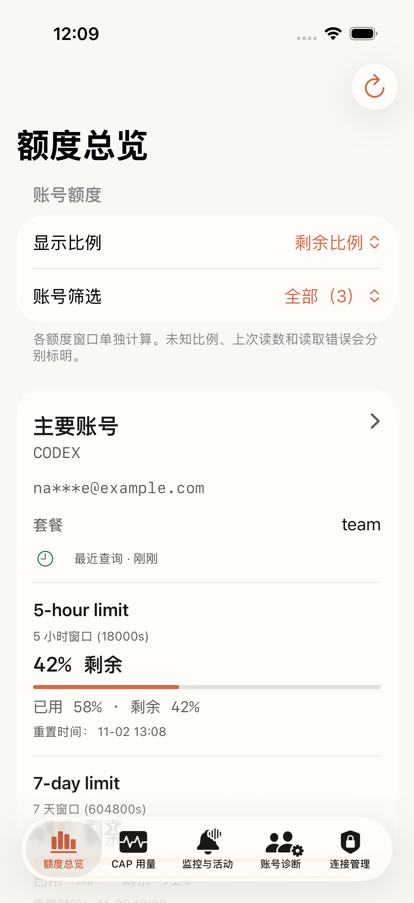
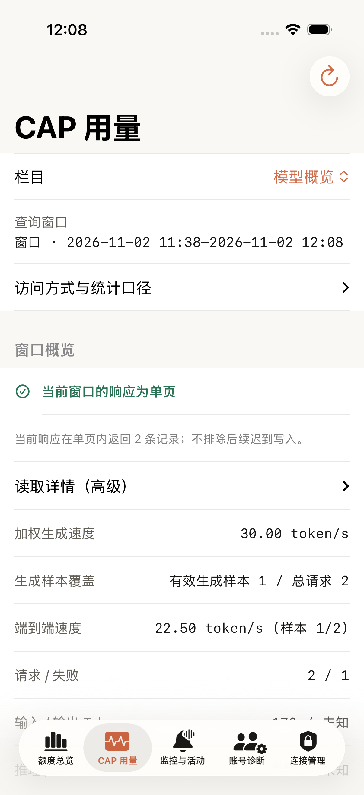
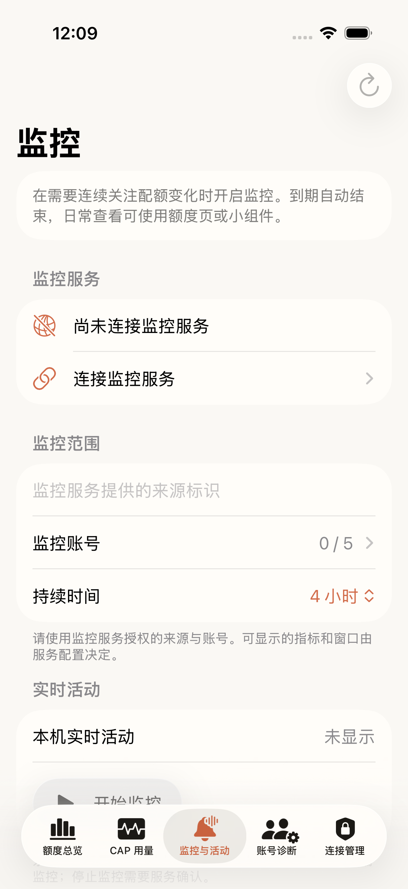
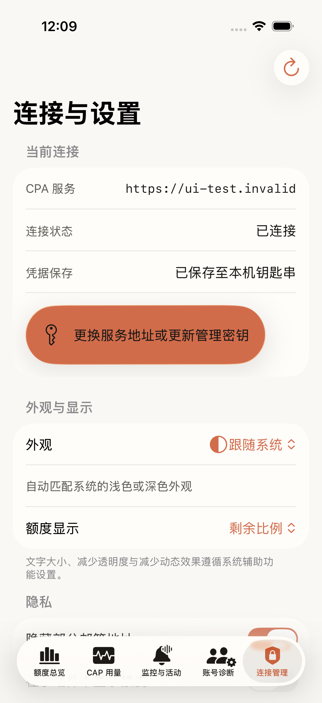

# CPA Quota

CPA Quota 是连接个人 CPA 服务、只读查看账号额度的原生 iOS 客户端，并提供可选的独立 Go 监控服务。

## 功能

- 查看 CPA 已有账号及额度窗口、重置时间和最近查询结果；读取失败时保留并标注上次成功结果。
- 查看 CAP 用量和账号诊断（CAP 用量依赖外部插件，详见下文），管理连接与本机偏好。
- 使用系统小组件和实时活动；小组件共享默认关闭，系统活动显示首个账号和其他账号数量，不承诺后台自动轮播。
- 可选地连接独立监控服务；服务需要另行配置、运行与授权。

当前界面为中文。应用只读查询，不登录上游 OAuth，也不修改账号、配置或重置额度。

## CAP 用量功能依赖

CPA Quota **不会自行采集 CAP Token 用量**。CAP 用量数据由 [CAP Token Usage Tracker](https://github.com/AITNR/cap-token-usage-tracker) 插件记录并提供；CPA Quota 通过该插件暴露的只读统计接口读取数据。

因此，**要完整使用 CPA Quota 的 CAP 用量功能，必须在 CPA 当前连接的 CLIProxyAPI 实例中安装并启用 `cap-token-usage-tracker` 插件**。只安装 CPA Quota iOS App 不足以提供 CAP 用量数据；插件应部署在 CLIProxyAPI 所在主机，并选择与 CLIProxyAPI 进程操作系统和 CPU 架构匹配的构建产物。

在 CLIProxyAPI 配置中启用插件（安装路径、平台选择和完整配置项请参见[插件安装与配置说明](https://github.com/AITNR/cap-token-usage-tracker#安装与配置)）：

```yaml
plugins:
  enabled: true
  dir: plugins
  configs:
    cap-token-usage-tracker:
      enabled: true
```

如果插件未安装、未启用或统计路由不可用，CAP 用量页面将无法读取相关数据并报告不可用/读取错误，而不会把插件缺失伪装成零用量。这不会影响 CPA 账号额度等不依赖 CAP 插件的功能。接口行为与数据完整性边界见 [CAP 用量后端接入合同](docs/CAP_USAGE_BACKEND.md)。

## 界面截图

以下截图来自 iPhone 17 Pro 模拟器、Xcode 26.2 的合成 UI 测试，使用示例账号与地址，不连接真实服务；监控页面展示未配置状态。来源为实现提交 `bbb4bcaa2906a67fe673282c4a4a62318c245d01` 的 [CI 运行 41441790484](https://github.com/rinmashiro0529/cpa-quota-ios/actions/runs/41441790484)。

| 额度总览 | CAP 用量 |
| --- | --- |
|  |  |
| 监控与活动（未配置） | 连接管理 |
|  |  |

## 要求

- iOS 17 或更高版本；macOS 14 或更高版本可用于支持的 Swift 包开发。最低系统真机兼容性尚未验收。
- 使用 Swift 6 和 Xcode 构建原生 App；独立监控服务需要 Go 1.26 或兼容工具链。
- 已获授权的 CPA HTTPS 地址及管理密钥；管理密钥不同于普通推理 API Key。

## 构建与连接

1. 克隆仓库，在 macOS 上用 Xcode 打开 `Apple/CPAQuota.xcodeproj`。
2. 选择共享方案 `CPAQuota` 和 iPhone 模拟器，然后运行。模拟器运行不等于真实设备、Keychain 或 APNs 验收。
3. 如需在真机安装，参照 [iOS 构建和签名指南](docs/NWD_IPA_BUILD.md) 为 App 与扩展配置团队、签名和所需能力。Linux/Darwin SDK 交叉编译的未签名 IPA 不是可直接安装的已签名版本。
4. 在连接管理中填写 CPA HTTPS 地址和管理密钥，验证连接后查看服务中已有账号及额度。管理凭据保存在设备 Keychain；不要提交真实凭据或生产配置。
5. 可按需开启小组件共享；实时活动的能力配置、账号选择和排障参见 [实时活动指南](docs/LIVE_ACTIVITY_SETUP.md)。签名、真实设备及 APNs 送达仍须独立验收。

## 可选监控服务

[部署指南](docs/MONITOR_DEPLOYMENT.md) 说明独立 Go 服务的离线构建、配置与受控部署；[服务合同](docs/MONITOR_SERVICE.md) 描述授权、容量、取消和持久化。监控访问令牌与 CPA 管理密钥分别配置。`dry_run=true` 禁止 APNs 发送，但有活动时仍可能采集 CPA，不能视为完全离线。结束本机显示不等于服务端监控已停止。

## 项目结构

| 路径 | 用途 |
| --- | --- |
| `Sources/CPAQuotaKit/` | 只读网络、额度、CAP、凭据与状态 |
| `Sources/CPAQuotaUI/` | 会话与 SwiftUI 界面 |
| `Sources/CPAQuotaActivity/`、`Apple/CPAQuotaActivityExtension/` | 实时活动与小组件 |
| `Sources/CPAQuotaApp/`、`Apple/CPAQuota.xcodeproj` | App 入口与原生工程 |
| `Services/QuotaMonitor/` | 可选的独立 Go 监控服务 |
| `Tests/`、`Apple/CPAQuotaAppUITests/`、`tools/tests/` | 合同、模型、原生 UI 与工具回归 |

## 测试与已知限制

常规 CI 包含源码/历史秘密扫描与 Duo 展开内屏冒烟验证。扫描匹配不被整目录忽略；只有经原始 Git 对象核对的精确源码散列可被分类为非凭据。复审范围和仍待验收的项目见[复审台账](docs/READINESS_REAUDIT_20261108.md)。

```powershell
python -I -X utf8 -B ci/validate_source_layout.py --root .
python -I -X utf8 -B ci/test_source_layout.py
python -I -X utf8 -B ci/test_activity_extension.py
python -I -B -m unittest discover -s tools/tests -p "test_*.py"
go -C Services/QuotaMonitor test ./...
go -C Services/QuotaMonitor vet ./...
```

当前提交的 CI 结果以对应 [GitHub Actions](https://github.com/rinmashiro0529/cpa-quota-ios/actions) 运行记录为准；历史成功不代表后续提交通过。模拟器和离线测试不能代替真实 CPA、签名、Keychain、真机与 APNs 验收。

## 安全、贡献与许可

请阅读 [安全政策](SECURITY.md)、[贡献指南](CONTRIBUTING.md) 和 [MIT 许可证](LICENSE)。公开前未完成的私密报告渠道、扫描、附件和素材权属等门禁见 [公开准备检查表](docs/OPEN_SOURCE_READINESS.md)。

## 文档

**当前指南**：[状态与验证](docs/MAIN_INTEGRATION_STATUS.md) · [构建和签名](docs/NWD_IPA_BUILD.md) · [实时活动](docs/LIVE_ACTIVITY_SETUP.md) · [监控部署](docs/MONITOR_DEPLOYMENT.md) · [前端接入](docs/FRONTEND_INTEGRATION.md) · [CAP 用量](docs/CAP_USAGE_BACKEND.md) · [Swift 监控](docs/MONITORING_SWIFT_BACKEND.md) · [桥接凭据](docs/MONITOR_BRIDGE_CREDENTIALS.md) · [监控服务](docs/MONITOR_SERVICE.md) · [文案准则](docs/COPY_STYLE.md)。

**历史开发记录**：以下文件记录特定时期的需求和验证，不代表当前提交的测试结果：[前端需求](FRONTEND_PROMPT.md) · [后端上下文](docs/BACKEND_CONTEXT.md) · [后端可靠性](docs/BACKEND_RELIABILITY_PR.md) · [后端验证](docs/BACKEND_VERIFICATION.md) · [前端审计](docs/FRONTEND_PR3_AUDIT.md) · [集成验证](docs/INTEGRATION_VERIFICATION.md) · [前端实现](docs/NATIVE_FRONTEND_IMPLEMENTATION.md) · [早期验证](docs/VERIFICATION.md)。
