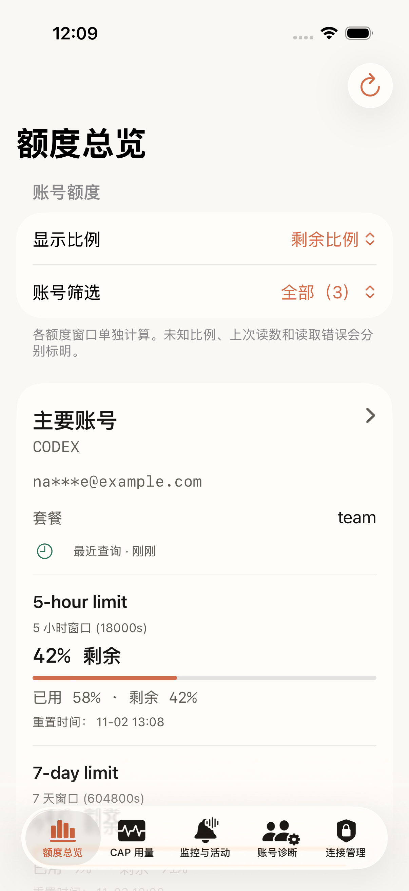
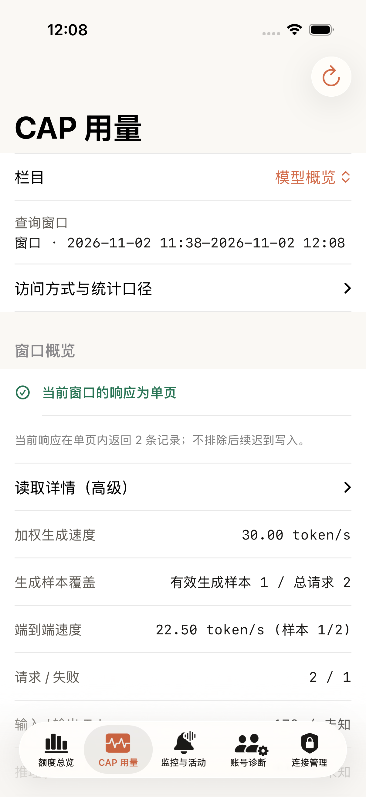
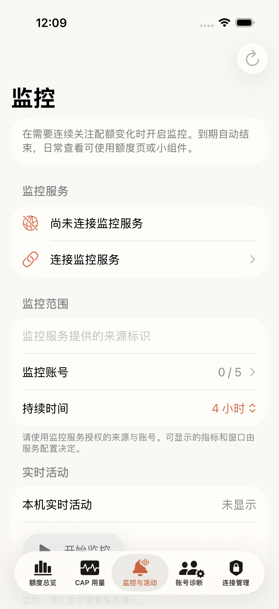
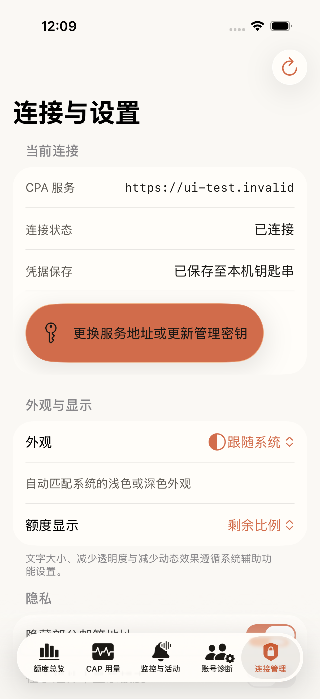

# CPA Quota

CPA Quota 是连接个人 CPA 服务的原生 iOS 客户端，提供只读的账号额度查询、CAP 用量统计与账号诊断、内置 AI 对话工作区，以及可选的独立 Go 监控服务。

## 功能

- **额度总览**：查看 CPA 已有账号及额度窗口（含 Codex 额度窗口）、重置时间和最近查询结果；读取失败时保留并标注上次读数。
- **CAP 用量与账号诊断**：查看 CAP 用量统计与时间范围分析（依赖外部插件，详见下文），以及账号状态诊断。
- **AI 对话**：使用 CPA 客户端 API Key 调用当前 CPA 暴露的模型进行流式对话，支持通用思考等级、中断续写、全局规则/记忆/斜杠技能、iOS 18.4+ HTML 代码块隔离预览、可选第三方联网搜索及约 30 秒后台继续生成与完成通知；数据与隐私边界详见 [AI 对话指南](docs/AI_CHAT.md)。
- **小组件与实时活动**：小组件共享默认关闭（在「连接管理 › 隐私 › 在小组件中显示额度」开启）；系统实时活动显示首个账号和其他账号数量，不承诺后台自动轮播。
- **可选独立监控服务**：入口在「连接管理」内的「监控与活动」页面，需另行配置、运行与授权。

当前界面为中文。额度、CAP 用量与账号诊断仅作管理面只读查询，不登录上游 OAuth，也不修改账号、配置或重置额度；**「AI 对话」会向 CPA 发送对话内容与图片并消耗上游额度，开启联网搜索时还会将消息正文发送给所选第三方搜索服务**（详见 [AI 对话指南](docs/AI_CHAT.md)）。

## CAP 用量功能依赖

CPA Quota **不会自行采集 CAP Token 用量**。CAP 用量数据由 [CAP Token Usage Tracker](https://github.com/AITNR/cap-token-usage-tracker) 插件记录并提供；CPA Quota 通过该插件暴露的只读统计接口读取数据。

因此，**要完整使用 CPA Quota 的 CAP 用量功能，必须在 CPA 当前连接的 CLIProxyAPI 实例中安装并启用 `cap-token-usage-tracker` 插件**。只安装 CPA Quota iOS App 不足以提供 CAP 用量数据；插件应部署在 CLIProxyAPI 所在主机，并选择与 CLIProxyAPI 进程操作系统和 CPU 架构匹配的构建产物。

在 CLIProxyAPI 配置中启用插件（安装路径、平台选择和完整配置项请参见[插件安装与配置说明](https://github.com/AITNR/cap-token-usage-tracker#安装与配置)）：

```yaml
plugins:
  enabled: true
  dir: plugins
  configs:
    cap-token-usage-tracker:
      enabled: true
```

如果插件未安装、未启用或统计路由不可用，CAP 用量页面将无法读取相关数据并报告不可用/读取错误，而不会把插件缺失伪装成零用量。这不会影响 CPA 账号额度等不依赖 CAP 插件的功能。接口行为与数据完整性边界见 [CAP 用量后端接入合同](docs/CAP_USAGE_BACKEND.md)。

## 界面截图（历史旧版预览）

> 以下 4 张截图摄于 2026-11-02 的历史实现提交 `bbb4bcaa2906a67fe673282c4a4a62318c245d01`（iPhone 17 Pro 模拟器、Xcode 26.2 合成 UI 测试，[CI 运行 41441790484](https://github.com/rinmashiro0529/cpa-quota-ios/actions/runs/41441790484)，不连接真实服务）。截图尚未反映后续合入的「AI 对话」工作区、「监控与活动」迁入「连接管理」内、连接页面标题更新以及 CAP 用量时间范围选择，待在 macOS / Xcode 27 环境下按当前 `main` 重新采集更新。

| 额度总览（旧版底栏） | CAP 用量（旧版界面） |
| --- | --- |
|  |  |
| 监控（旧版独立标签页，未配置） | 连接与设置（现已更名为「连接管理」） |
|  |  |

## 要求

- **运行系统**：iOS 17 或更高版本（其中 AI 对话 HTML 静态预览需 iOS 18.4 及以上）；macOS 14 或更高版本可用于支持的 Swift 包开发。最低系统真机兼容性尚未验收。
- **构建工具链**：原生 App 需要 Swift 6 与 **Xcode 26 或更高版本（iOS 26 SDK）**（因界面在 `#available(iOS 26.0, *)` 中使用 `glassEffect`，主 CI 使用 Xcode 27.1）；首次构建需信任 `AnyLanguageModel` 与 `Equatable` 的 Swift Macros（Xcode 中确认 Trust & Enable，或参考 `ci/install_trusted_swift_macros.sh`）。独立监控服务需要 Go 1.26 或兼容工具链。
- **服务与凭据**：已获授权的 CPA HTTPS 地址及 CPA 管理密钥；管理密钥与用于 AI 对话推理的 CPA 客户端 API Key 用途不同。

## 构建与连接

1. 克隆仓库，在 macOS 上用 Xcode 26+ 打开 `Apple/CPAQuota.xcodeproj`，首次加载依赖时按提示信任 Swift Macros。
2. 选择共享方案 `CPAQuota` 和 iPhone 模拟器，然后运行。模拟器运行不等于真实设备、Keychain 或 APNs 验收。
3. 如需在真机安装，参照 [iOS 构建和签名指南](docs/NWD_IPA_BUILD.md) 移除/覆盖工程中为无签名 CI 设置的签名禁用项，并为 App 与扩展分别配置团队、签名和所需能力。Linux/Darwin SDK 交叉编译的未签名 IPA 不是可直接安装的已签名版本。
4. 在「连接管理」中填写 CPA HTTPS 地址和 CPA 管理密钥，验证连接后查看服务中已有账号及额度。管理密钥保存在设备 Keychain；不要提交真实凭据或生产配置。
5. 如需使用 AI 对话，进入「AI 对话 › 对话设置」自动选取或手动填写 CPA 客户端 API Key，并按需配置模型、记忆、技能或第三方联网搜索（详见 [AI 对话指南](docs/AI_CHAT.md)）。
6. 可在「连接管理 › 隐私 › 在小组件中显示额度」开启小组件共享；实时活动的能力配置、授权流程和排障参见 [实时活动指南](docs/LIVE_ACTIVITY_SETUP.md)。签名、真实设备及 APNs 送达仍须独立验收。

## 可选监控服务

[部署指南](docs/MONITOR_DEPLOYMENT.md) 说明独立 Go 服务的离线构建、配置与受控部署；[服务合同](docs/MONITOR_SERVICE.md) 描述授权、容量、取消和持久化。「监控与活动」是「连接管理」内的页面，不再是独立标签页。监控访问令牌与 CPA 管理密钥、CPA 客户端 API Key 分别配置。`dry_run=true` 禁止 APNs 发送，但有活动时仍可能采集 CPA，不能视为完全离线。结束本机显示不等于服务端监控已停止。

## 项目结构

| 路径 | 用途 |
| --- | --- |
| `Sources/CPAQuotaKit/` | 只读管理网络、额度、CAP、客户端 API Key 发现、凭据与状态 |
| `Sources/CPAQuotaChat/` | AI 对话引擎、索引懒加载与附件外置持久化、联网搜索、后台续跑与工作区状态 |
| `Sources/CPAQuotaUI/` | 会话与 SwiftUI 界面（含 AI 对话与隔离 HTML 预览） |
| `Sources/CPAQuotaActivity/`、`Apple/CPAQuotaActivityExtension/` | 实时活动与小组件 |
| `Sources/CPAQuotaApp/`、`Apple/CPAQuota.xcodeproj` | App 入口与原生工程 |
| `Services/QuotaMonitor/` | 可选的独立 Go 监控服务（仅使用标准库） |
| `Tests/`、`Apple/CPAQuotaAppUITests/`、`tools/tests/` | 合同、模型、原生 UI 与工具回归 |

SwiftPM 直接第三方依赖（`Package.swift`）：`huggingface/AnyLanguageModel`（Apache-2.0）、`apple/swift-http-types`（Apache-2.0）、`swiftlang/swift-markdown`（Apache-2.0）与 `microsoft/SwiftStreamingMarkdown`（MIT，仅 iOS 目标使用）；全部传递依赖及 `robert-garay/openchat` 参考实现的完整许可与 `NOTICE` 声明见 [THIRD_PARTY_NOTICES.md](THIRD_PARTY_NOTICES.md)。

## 测试与已知限制

常规 CI 包含源码/历史秘密扫描与 Duo 展开内屏冒烟验证。扫描匹配不被整目录忽略；只有经原始 Git 对象核对的精确源码散列可被分类为非凭据。历史复审范围和仍待验收的项目见[复审台账（英文）](docs/READINESS_REAUDIT_20261108.md)与 [发布与合并门禁](docs/RELEASE_GATES.md)。

```powershell
python -I -B ci/validate_public_copy.py --root .
python -I -X utf8 -B ci/validate_source_layout.py --root .
python -I -X utf8 -B ci/test_source_layout.py
python -I -X utf8 -B ci/test_activity_extension.py
python -I -B -m unittest discover -s tools/tests -p "test_*.py"
go -C Services/QuotaMonitor test ./...
go -C Services/QuotaMonitor vet ./...
```

在具备 Swift 6 工具链的 macOS 或 Linux 环境可额外运行 `swift test --disable-automatic-resolution`。当前提交的 CI 结果以对应 [GitHub Actions](https://github.com/rinmashiro0529/cpa-quota-ios/actions) 运行记录为准；历史成功不代表后续提交通过。模拟器和离线测试不能代替真实 CPA、签名、Keychain、真机与 APNs 验收。

## 安全、贡献与许可

请阅读 [安全政策](SECURITY.md)、[贡献指南](CONTRIBUTING.md)、[MIT 许可证](LICENSE)、[第三方许可声明](THIRD_PARTY_NOTICES.md) 和 [变更日志](CHANGELOG.md)。仓库已公开并启用 GitHub 私密漏洞报告与秘密扫描；公开后仍待核验或完成的分支保护、素材权属与真机验收等门禁见 [公开准备检查表](docs/OPEN_SOURCE_READINESS.md) 与 [发布与合并门禁](docs/RELEASE_GATES.md)。

## 文档

- **用户与部署指南**：[AI 对话指南](docs/AI_CHAT.md) · [构建和签名](docs/NWD_IPA_BUILD.md) · [实时活动与监控](docs/LIVE_ACTIVITY_SETUP.md) · [监控部署](docs/MONITOR_DEPLOYMENT.md) · [变更日志](CHANGELOG.md)
- **开发与协议合同**：[CPAQuotaKit 接入合同](docs/FRONTEND_INTEGRATION.md) · [CAP 用量合同](docs/CAP_USAGE_BACKEND.md) · [Swift 监控后端](docs/MONITORING_SWIFT_BACKEND.md) · [凭据存储合同](docs/MONITOR_BRIDGE_CREDENTIALS.md) · [监控服务合同](docs/MONITOR_SERVICE.md) · [文案准则](docs/COPY_STYLE.md)
- **安全与发布门禁**：[安全政策](SECURITY.md) · [发布与合并门禁](docs/RELEASE_GATES.md) · [公开准备检查表](docs/OPEN_SOURCE_READINESS.md) · [第三方许可声明](THIRD_PARTY_NOTICES.md)
- **历史开发与审计记录**（仅反映各自基线与时点，不代表当前提交结果）：[主线集成状态（2026-11-03 基线）](docs/MAIN_INTEGRATION_STATUS.md) · [审计整改对照（2026-11-07）](docs/AUDIT_REMEDIATION_20261107.md) · [主线稳定化记录（2026-11-08）](docs/MAIN_STABILIZATION_20261108.md) · [复审台账（2026-11-08，英文）](docs/READINESS_REAUDIT_20261108.md) · [前端需求](FRONTEND_PROMPT.md) · [后端上下文](docs/BACKEND_CONTEXT.md) · [后端可靠性](docs/BACKEND_RELIABILITY_PR.md) · [后端验证](docs/BACKEND_VERIFICATION.md) · [前端审计](docs/FRONTEND_PR3_AUDIT.md) · [集成验证](docs/INTEGRATION_VERIFICATION.md) · [前端实现](docs/NATIVE_FRONTEND_IMPLEMENTATION.md) · [早期验证](docs/VERIFICATION.md)
