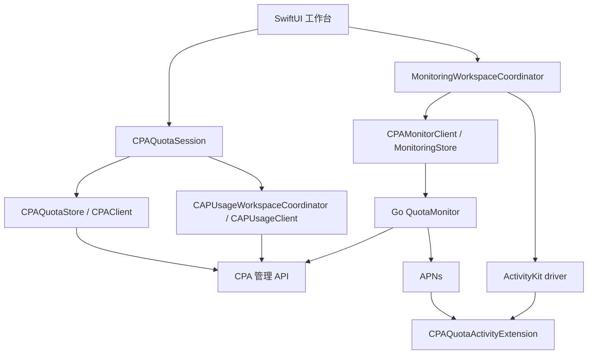

# PR #3 集成审计与修复说明

## 01 — 结论与可复现范围

**结论：PR #3 的产品方向可以保留，原提交不具备合并或发布条件。采用渐进式修复，并定向重整监控协调器与 ActivityKit 内容模型；没有证据支持整体重写。** 本补丁以 PR #3 为 base，避免把它尚未合并的功能算进 `main`。本报告是前一次全项目审计的跟进，重点复验新增前端与项目本体的连接，不声称重新动态验收所有平台和生产链路。

2026-10-29 15:09:41 UTC 实际枚举到三个 PR，包含全部 open/closed 状态：

| 对象 | 状态与固定版本 | 本轮用途 |
| --- | --- | --- |
| `main` | `1ee5ba9c6a95abaa7875497d8732e49ff18d6287` | 已包含 PR #1、#2 的 Kit、Go 服务及 CI |
| [PR #1](https://github.com/rinmashiro0529/cpa-quota-ios/pull/1) | merged；head `4f2929373c5ffe5f80fe385df8212341fae4e4d9` | 原 CAP/监控合同与既有技术债 |
| [PR #2](https://github.com/rinmashiro0529/cpa-quota-ios/pull/2) | merged；head `a9b08fac3eb0704a09b742ada4b2c2caad4d9c7d` | 已修复的后端可靠性边界；本轮不倒退这些语义 |
| [PR #3](https://github.com/rinmashiro0529/cpa-quota-ios/pull/3) | open、draft；head `aa01caab819aa8112740060814e3fb23128a9220` | 本轮审计基线：1 commit，13 files，+3323/-13 |

PR #3 base 就是上述 `main`；tree 为 `27567498f2f1ffdea316acc44cf526f4abb7f6f3`。抓取时 PR #3 的 reviews、review comments、issue comments 均为空，没有可供继承的审核通过结论。其说明明确称未完成验证；本轮把这些说明当线索，结论来自源码和执行。

[基线 CI run 40897099378](https://github.com/rinmashiro0529/cpa-quota-ios/actions/runs/40897099378)：Go tests/race/vet 与 Linux/Windows build 成功；Swift job `123529105490` 在 macOS 编译 `MonitoringTabView` 时失败，测试及后续 iOS 步骤跳过。错误包括通过不可变 `session.monitoringCoordinator` 建立嵌套 binding，以及未做平台保护的 `textInputAutocapitalization`。因此“存在测试文件”不能证明 PR #3 的测试运行过。

**A / B / C 的区分：** A 是上述 main 已实现的协议、服务和额度链路；B 是 PR #3 新增工作台与活动代码；C 是 main + PR #3 + 本修复形成的目标集成状态。C 的模型测试、平台构建、模拟器测试与真机推送必须分别记录，不能互相替代。

## 02 — 架构与功能清单

### 已确认的调用链

额度与 CAP 共享已接受连接的管理请求协调器，保留 401/403 断路和 429 冷却。CAP 资源鉴权仍由用户显式选择匿名或管理密钥；失败时不会自动切换认证。用量窗口是固定的最近 30 分钟窗口；分页、聚合和成本语义继续使用 Kit 已有实现，不重新计算一套 UI 专用统计。

监控桥接是独立 HTTPS 地址和独立 bearer token。桥接令牌保存在独立 Keychain service 下，不与 CPA 管理密钥混用。服务端负责采集、租约、持久取消意图、APNs update/end；客户端负责明确的注册/查询/停止意图、原连接归属以及系统活动关联。`DELETE 204` 是服务端持久停止意图的证据，`GET 404` 不是停止证明。APNs 接受也不是设备送达证明。

PR #3 新增 CAP 四类页面、监控配置/注册/历史页、本地 ActivityKit driver、Widget 定义与合成测试。原 `DynamicIslandCompanionBar` 仍是应用内状态栏；它在 PR #3 已有文字区分系统活动，这部分保留。原工程没有 Widget extension，因此不能把该定义算成已可交付的系统活动。

### 本补丁的边界

- 保留 `CPAQuotaKit` 的 CPA、CAP、监控 HTTP 合同、Go 持久化/调度和现有页面设计。
- Session 在一个 MainActor 发布区间内同时提交 quota store、连接身份和 CAP client；所有准备性 `await` 位于发布之前。
- CAP 四类请求各自拥有请求 ID、取消句柄与数据窗口。旧结果及旧 `defer` 无权收尾新请求。
- 监控协调器以当前连接、固定注册意图和活动身份为核心。记录键包括规范化桥接地址、受保护凭据的 opaque binding ID、会话 UUID。
- 新增 `CPAQuotaActivity` 小模块，依赖 Kit，供 App 和 Widget 扩展共享同一个 Attributes/ContentState。扩展不依赖整个 UI 模块，也不主动读取管理凭据或访问网络。
- 新增实际 extension target、入口、嵌入步骤和 App Push Notifications 配置；签名及 APNs 环境仍由部署者提供。

## 03 — 质量与证据量表

不以“文件多、测试多、抽象多”评分。本轮只对以下十个可复验交付闸门计分，每项 1 分；这是 **PR #3 集成风险的检查分**，不是对未复验的全项目给出综合质量分。

| 闸门 | 原 PR #3 | 本补丁验收证据 |
| --- | --- | --- |
| macOS SwiftPM 编译与测试 | 0：实际 CI 编译失败 | 完整 Swift job |
| 原生 iOS 编译与模型测试 | 0：基线步骤跳过 | Xcode native test job |
| Go 服务既有回归与 race/vet | 1：实际 CI 成功 | 本地复跑与新 PR Go job |
| quota 与 CAP 连接原子发布 | 0：负对照复现 A/B 错配 | 两条发布交错回归 |
| 请求替换与外层取消 | 0：负对照复现 | 四类请求取消/收尾回归 |
| 历史会话身份隔离 | 0：原 UI 绕过归属检查 | 跨地址、跨凭据、迁移回归 |
| 本机忘记后的访问边界 | 0：原客户端/回调仍保留 | 忘记、延迟保存、晚结果回归 |
| 首 token 与轮换时序 | 0：原正常异步首 token 被丢弃 | 固定意图、迟到回调、CAS 回归 |
| Swift ContentState 与 Go 内容一致 | 0：字段结构不兼容 | 共用 fixture 的 update/end 解码及真实编码预算 |
| 可执行 Widget 已嵌入产物 | 0：原无 extension target | 构建后检查 `.appex`、Mach-O、平台和框架 |

基线可确认 **1/10**。该低分表明新增集成尚未过关，不代表已合并的 Kit/Go 代码只有十分之一可保留。本补丁只在对应执行结果已通过后计入通过项；最终验证详情以本报告第 06 节及 PR head 的 CI 为准。真机送达、UI 手势、VoiceOver、能耗不在这十分中，仍单列未知项。

## 04 — Findings Register

下列位置均指 PR #3 原始 head。`Verified` 表示实际执行或确定的结构证据；`Code-supported` 表示明确路径但未用原生平台动态复现。没有把 Hypothesis 升格为阻断事实，也没有发现已证实的 P0。

### FE-01 · P1 · 编译和测试夹具脱离真实接口 · Verified

**位置：** [MonitoringTabView.swift](https://github.com/rinmashiro0529/cpa-quota-ios/blob/aa01caab819aa8112740060814e3fb23128a9220/Sources/CPAQuotaUI/MonitoringTabView.swift#L161)、[FrontendCloudIntegrationTests.swift](https://github.com/rinmashiro0529/cpa-quota-ios/blob/aa01caab819aa8112740060814e3fb23128a9220/Tests/CPAQuotaKitTests/FrontendCloudIntegrationTests.swift#L33)。

**根因/影响：** 嵌套 Observation binding 及 iOS 专用 modifier 阻断 macOS build；测试引用不存在的 `selectedTab`、`populateAccountsFromCPASession`，mock CAP 路径也不是 Kit 的 `/v0/resource/plugins/cap-token-usage-tracker/...`。mutable UUID 的 Sendable 捕获进一步降低测试可信度。

**复现：** 基线 CI 已失败；纠正编译后，原 mock 的真实 CAP 请求会落入 404 分支。**修复：** View 直接绑定 coordinator，平台保护；夹具匹配真实 API，transport actor 从实际 POST 捕获 UUID。**验收：** 完整 SwiftPM 与 native test 均实际执行，不跳过新文件。工作量约 0.5–1 日，包含 CI 排障。

### FE-02 · P1 · 已接受额度连接与 CAP 凭据错配 · Verified

**位置：** [CPAQuotaSession.swift](https://github.com/rinmashiro0529/cpa-quota-ios/blob/aa01caab819aa8112740060814e3fb23128a9220/Sources/CPAQuotaUI/CPAQuotaSession.swift#L758)，恢复路径约 579–586。

**根因：** 发布 B 的 store/server 后 `await makeCAPUsageClient()`；C 在该挂起点开始并失败，代次 guard 阻止 B 的 CAP 绑定，留下 quota B / CAP A。**影响：** 界面连接与真实用量请求身份不一致。

**复现：** 负对照两条 connect/restore 路径都观察到 `currentServer=B`，CAP 请求仍为 A 的 host 与合成凭据。**修复：** 先从候选 store 准备 CAP client，再无挂起地共同发布。**验收：** 失败 C 不破坏已接受 B 的 quota/CAP 身份；忘记/恢复失败同步清 CAP。约 0.5–1 日。

### FE-03 · P1 · 旧请求收尾覆盖新请求，取消未传播 · Verified

**位置：** [CAPUsageCoordinator.swift](https://github.com/rinmashiro0529/cpa-quota-ios/blob/aa01caab819aa8112740060814e3fb23128a9220/Sources/CPAQuotaUI/CAPUsageCoordinator.swift#L91)。

**根因：** 同连接的替换请求共用 generation；旧完成路径可把新 task handle 设空，旧 management/page catch/defer 可发布错误并提前结束 loading；外层任务取消没有传给内部 Task。**影响：** 用户取消后请求继续、错误覆盖当前读数、并行操作状态失真。

**复现：** 两个 gate 控制先后返回；旧实现的句柄、loading/error 与四类外层取消负对照全部失败。**修复：** 每个请求独立 UUID，所有 publish/finalize 绑定 UUID+连接代次；显式 cancellation handler。**验收：** 无论旧任务成功、取消或报错，都不能改变替换任务；取消后无新快照。约 1–2 日。

### FE-04 · P2 · 数据窗口与分页口径漂移 · Code-supported，修复有回归

**位置：** [CAPUsageCoordinator.swift](https://github.com/rinmashiro0529/cpa-quota-ios/blob/aa01caab819aa8112740060814e3fb23128a9220/Sources/CPAQuotaUI/CAPUsageCoordinator.swift#L153)、[CAPUsageTabView.swift](https://github.com/rinmashiro0529/cpa-quota-ios/blob/aa01caab819aa8112740060814e3fb23128a9220/Sources/CPAQuotaUI/CAPUsageTabView.swift)。

**条件/影响：** 总览刷新到新窗口，旧 details/page/management 数据保留，却沿用总览时间标签；翻页又组合新窗口与旧 offset，比较结果失去统一口径。**修复：** 每份成功数据持有窗口；分页继续显示中的窗口，“当前窗口首页”明确换窗；失败保留数据及其原时间。**验收：** 刷新总览不会改旧数据标签；下一页 URL 的 start/end 仍等于该页所属窗口。约 0.5–1 日。

### FE-05 · P2 · 未知结果和未知计价覆盖被渲染为成功 · Code-supported，修复有回归

**位置：** [CAPUsageTabView.swift](https://github.com/rinmashiro0529/cpa-quota-ios/blob/aa01caab819aa8112740060814e3fb23128a9220/Sources/CPAQuotaUI/CAPUsageTabView.swift#L685)、[CAPUsageCoordinator.swift](https://github.com/rinmashiro0529/cpa-quota-ios/blob/aa01caab819aa8112740060814e3fb23128a9220/Sources/CPAQuotaUI/CAPUsageCoordinator.swift#L266)。

**根因：** `failed=nil` 走成功文字；缺失的 unpriced count 当作 0 参与颜色/可靠性提示。**修复：** 显式成功/失败/未知；仅当 requests/priced/unpriced 相互一致且无 missing price 才显示已知覆盖。趋势超过 20 项时明确告知显示截断。**验收：** nil、不一致计数、缺价都不能产生绿色完整性暗示；零费用与未知费用仍区分。约 0.5 日。

### FE-06 · P1 · 历史会话经错误桥接读取并被重新归属 · Code-supported

**位置：** [MonitoringTabView.swift](https://github.com/rinmashiro0529/cpa-quota-ios/blob/aa01caab819aa8112740060814e3fb23128a9220/Sources/CPAQuotaUI/MonitoringTabView.swift#L617)、[MonitoringWorkspaceCoordinator.swift](https://github.com/rinmashiro0529/cpa-quota-ios/blob/aa01caab819aa8112740060814e3fb23128a9220/Sources/CPAQuotaUI/MonitoringWorkspaceCoordinator.swift#L498)。

**条件：** A 的历史 UUID X 经当前 B 的 store.load；B 无 X 返回 404，随后 B 对未知 X 的 DELETE 204 被记为取消证明。原 upsert 只按 UUID，还可把历史桥接覆盖为 B。**影响：** A 仍采集，界面却误认为已停止。

**反证：** Go 正确地对同桥接已有的另一 principal 会话返回不可见；本问题不是声称 Go 允许删除他人的已有会话。错桥接、未知或在途 UUID 才是需要区分的条件。

**修复：** URL+opaque credential binding+UUID 作用域；所有历史操作走 coordinator。跨凭据/旧无 binding 记录只可在原 URL GET，且响应 ID/source/accounts/activity/revision 校验成功后显式接管；404 保留原归属与未知状态，不授予停止回执。**验收：** 错地址零请求；错凭据 404 零重归属；同 principal 令牌轮换可经成功 GET 恢复。约 1–2 日。

### FE-07 · P1 · 本机忘记及来源缓存绕过当前凭据边界 · Verified（缓存/忘记负对照）

**位置：** [MonitoringWorkspaceCoordinator.swift](https://github.com/rinmashiro0529/cpa-quota-ios/blob/aa01caab819aa8112740060814e3fb23128a9220/Sources/CPAQuotaUI/MonitoringWorkspaceCoordinator.swift#L322)，来源缓存约 539–563。

**根因：** 删除 Keychain 后仍保留 store、detached client 和活动回调；缓存读取重新从 Keychain 建 client，临时连接不可用，同地址临时新 token 还可能读旧 token，并绕开旧 client 的冷却/鉴权状态。

**修复：** 忘记后撤销当前/分离客户端引用和监听，保留非秘密索引及“远端未停止”的说明；来源缓存复用当前 client，并绑定来源及连接。配置操作串行，避免被替换的 Keychain 写入与内存连接分叉。**验收：** 忘记完成后的按钮/旧回调不能再发请求或更新状态；在途响应不能回填；临时 token 与冷却状态均被遵守；保存/删除失败有可见状态。已发出的网络请求可能在服务端完成，不能用本机忘记承诺撤回。约 1–2 日。

### FE-08 · P1 · 首次 token 正常异步到达时无法注册，重试重建活动 · Verified（首 token 负对照）

**位置：** [MonitoringWorkspaceCoordinator.swift](https://github.com/rinmashiro0529/cpa-quota-ios/blob/aa01caab819aa8112740060814e3fb23128a9220/Sources/CPAQuotaUI/MonitoringWorkspaceCoordinator.swift#L415)。

**根因：** Activity.request 返回时 token 可以为空；原回调又要求远端 session 已存在，形成启动闭环。重试再次 request 活动；UUID 与注册参数未作为不可变意图保存。**修复：** 先固定 UUID/source/accounts/duration；只创建一次活动并等待其 token；同 UUID 重试先 GET，再使用同一注册内容。等待期间刷新或历史操作不能清掉本地意图。**验收：** nil 首 token→晚到 token 只发一次 POST；重复按钮不增加活动；超时不换 UUID/参数；未提交时取消仅结束精确本地活动。约 1–2 日。

### FE-09 · P1 · 活动恢复、旧回调与 token CAS 缺少身份约束 · Code-supported

**位置：** [SystemLiveActivitySupport.swift](https://github.com/rinmashiro0529/cpa-quota-ios/blob/aa01caab819aa8112740060814e3fb23128a9220/Sources/CPAQuotaUI/SystemLiveActivitySupport.swift#L156)，结束路径 204–220。

**根因：** driver 不恢复已有活动；`activeActivityID=nil` 被解释为结束全部同类活动；token 回调不携带活动 ID，旧观察任务可能把 A token 写到 B session。并发轮换没有统一顺序。

**修复：** 精确 ID/source restore、update/end 必须指定 ID；driver 观察代次与 coordinator 连接代次双重检查；单个轮换任务合并最新 token，CAS 失败最多一次 GET 和一次重试。恢复的初始 token 不能覆盖已经到达的更新 token。**验收：** 恢复/停止 A 不影响 B；旧回调不能 PATCH B；两枚快速 token 最终保存最新；失败不无限重试。约 1–2 日，原生观察流仍需真机验证。

### FE-10 · P1 · ActivityKit 的真实 JSON 合同和体积预算错误 · Verified

**位置：** [SystemLiveActivitySupport.swift](https://github.com/rinmashiro0529/cpa-quota-ios/blob/aa01caab819aa8112740060814e3fb23128a9220/Sources/CPAQuotaUI/SystemLiveActivitySupport.swift#L13)、[Go APNs provider](https://github.com/rinmashiro0529/cpa-quota-ios/blob/aa01caab819aa8112740060814e3fb23128a9220/Services/QuotaMonitor/apns/provider.go#L138)。

**根因：** Swift 合成 Codable 期待 `{snapshotData: Base64, focusedIndex}`，Go 直接发送 v1 Snapshot 字段。原检查只量内部 Snapshot，不量 Base64 后的系统内容。五个合法账号可构造 3365-byte Snapshot，却得到超过 4 KiB 的封装。

**修复：** ContentState Codable 直接委托 Snapshot，账号选择仅属本地展示。保留 3584-byte 动态内容预算，静态属性另限 512 bytes，校验真实编码总量。**验收：** shared fixture 的 update/end content-state 都可直接解码，重新编码语义相等；上限、Unicode、转义和旧封装拒绝都有测试。约 0.5–1 日。

### FE-11 · P1 · Widget 定义没有实际扩展产品 · Verified（工程结构）

**位置：** [project.pbxproj](https://github.com/rinmashiro0529/cpa-quota-ios/blob/aa01caab819aa8112740060814e3fb23128a9220/Apple/CPAQuota.xcodeproj/project.pbxproj)、[Apple/Info.plist](https://github.com/rinmashiro0529/cpa-quota-ios/blob/aa01caab819aa8112740060814e3fb23128a9220/Apple/Info.plist)。

原提交仅加 `NSSupportsLiveActivities`，没有 Widget extension target、入口与 embed。**修复：** 共享 Activity 模块、`CPAQuotaActivityExtension`、`WidgetBundle`、独立 bundle ID、App target 依赖及嵌入；Push capability 和 entitlement 环境按 build configuration 配置。**验收：** 原生编译，并在实际产物中验证 `.appex` plist、MH_EXECUTE、arm64 平台、minimum OS、ActivityKit/WidgetKit 链接。未签名构建不证明 provisioning 或 APNs 成功。约 1 日，签名真机验收另计。

### FE-12 · P1/P2 · 旧 HTTP 内容覆盖推送，陈旧值与不合法索引失真 · Code-supported

**位置：** [SystemLiveActivitySupport.swift](https://github.com/rinmashiro0529/cpa-quota-ios/blob/aa01caab819aa8112740060814e3fb23128a9220/Sources/CPAQuotaUI/SystemLiveActivitySupport.swift#L191)，展示 415–499，索引 35–44。

**根因：** 本地 update 不比较系统已持有的序号；数字优先显示，未展示 context.isStale；负索引可能越界，Int.max 加一可溢出。**修复：** 新序号才允许镜像，iOS 17.2+ 用原始 generatedAt timestamp 让系统拒绝晚到旧内容；17.0/17.1 保守交给 APNs 更新。Widget 显示陈旧、失败、限流和终态，安全归一化本地索引。**验收：** 旧/同序不同内容拒绝；边界索引不崩溃；状态与数值同时诚实展示。时钟偏移及真实并发 APNs 仍需设备试验。约 0.5–1 日。

### FE-13 · P2 · 新页面的全局刷新仍读取全部额度 · Code-supported，修复有回归

**位置：** [CPAQuotaRootView.swift](https://github.com/rinmashiro0529/cpa-quota-ios/blob/aa01caab819aa8112740060814e3fb23128a9220/Sources/CPAQuotaUI/CPAQuotaRootView.swift#L46)、[FloatingGlassTabBar.swift](https://github.com/rinmashiro0529/cpa-quota-ios/blob/aa01caab819aa8112740060814e3fb23128a9220/Sources/CPAQuotaUI/FloatingGlassTabBar.swift#L49)。

**修复：** 用量页刷新 CAP 总览，监控页只核对会话，其他页按原额度语义；监控忙时禁用全局读按钮，绝不把“取消读取”映射到服务端停止。去掉两个新页重复垂直 ScrollView，由 root 统一布局与 refresh；选中 tab 增加 accessibility trait。**验收：** 用量刷新只有 CAP 请求；未配置监控不启动 CPA 请求、不创建 session；原生手势单独验收。约 0.5 日。

### 与 main 既有发现的关系

| 既有问题 | 本次处理 | 限制 |
| --- | --- | --- |
| F10：401/403 后同 client 的重新验证无效 | 删除该状态下无效按钮，明确通过连接/凭据入口重新连接 | 保留 429 冷却，不提供自动绕过 |
| F13：displayName 回退为邮箱时绕过遮蔽 | 三个账号标题复用邮箱遮蔽规则 | 不宣称任意自由文本已完成 PII 检测 |
| F19：详情页单账号按钮全量刷新 | 调用既有 `refreshAccount(account.id)` | 不改变额度采集实现 |
| F14：CPA 候选凭据取消事务 | **未在本补丁全面解决** | Session 原凭据协调器需独立 vault 内容/补偿测试 |
| F15：历史 CPA Keychain 清理索引 | **未迁移** | 需受保护凭据所有权索引及升级/回滚设计 |
| F17：全局字体、对比度与小屏 | 局部状态和 Widget 语义字体改进 | 全应用 Dynamic Type、VoiceOver、截图未验收 |

## 05 — 逐 PR 判断与合并关系

PR #1、#2 已在 main，保留其已验证的共享协议、Go CAS/取消与故障恢复资产。本轮复跑 Go 回归，未用前端问题作为重新设计服务端协议的理由。既有 CPA credential 事务债务继续登记，不能被新 CAP 绑定修复自动算作已关闭。

**PR #3 建议：Revise。** 真实需求是把已有 CAP 和监控能力接入产品；页面信息与后端客户端复用方向合理。其原提交有确定编译阻断和身份/活动合同问题，不能按描述或测试数量接受。补丁选择增量修复，而不取消整套功能或引入通用 manager/event bus。

本修复 PR 应先针对 PR #3 分支审核；待依赖链内容整体就绪后再决定 PR #3 进入 main 的顺序。新 PR 的绿色检查不等于 PR #3 的旧 head 变绿，也不等于所有既有发布债务已清除。

## 06 — 测试与验证差距

已执行的独立验证：

- 原 PR #3 CI：Go 成功，macOS Swift 编译失败，native steps 跳过。
- 本地 Go 1.26.10：`go test -race -count=1 ./...` 五个包成功；`go vet ./...` 成功。依赖下载关闭，仅合成本地测试。
- Swift 6.2.4/Linux，warnings-as-errors：CAP 与 Activity 两组筛选测试成功。测试不是 ActivityKit 设备执行。
- CAP 负对照：隔离副本还原 PR #3 精确 coordinator/Session/View，保留其他编译兼容补丁，仅执行旧 API 可运行的四个回归声明、12 个参数场景；全部失败，共 24 个断言 issue。修复后同组成功。这不是声称原始 PR #3 全套可编译。
- 监控负对照：隔离的原始 PR #3 产品源码配最小反例测试，3 tests / 6 条断言实际失败，证明临时连接缓存不发请求、forget 后旧 store 继续 GET、首 token 丢失。此负对照在实现后补做，没有宣称先写红测再修复。
- Python packaging gate：六项正/负向测试成功；source membership 自测五项成功。

完整 Swift 6.2.4/Linux + warnings-as-errors 已执行通过：**288 tests / 42 suites**，包含新增监控专项的 15 个测试。原生测试源接线为 **36/36**，Swift 源清单 **87** 项，无遗漏/重复/悬空引用。Apple 验证以本 PR 当前 head 的 GitHub Actions Checks 与 PR 描述为准；本地执行记录见 [验证清单](verification/frontend-pr3-20261029.json)，不把 Linux 通过外推为 Apple 通过。所有本地日志仅含合成测试数据。

本修复首轮 [CI 40902368779](https://github.com/rinmashiro0529/cpa-quota-ios/actions/runs/40902368779) 的 macOS SwiftPM 实际通过 **286 tests / 42 suites**；iOS SDK 编译另外发现 `Activity` 非 Sendable 对象跨 MainActor 调用非隔离 async API 的问题。后续修复把精确 ID 的查找、序号检查和 SDK 操作放在同一个非隔离 helper 内，仅传递 Sendable 值类型，没有降低 strict concurrency 或添加 unchecked Sendable。原生执行结果继续按最新提交的 Checks 记录。

| 风险场景 | 验证方式 | 仍不能据此证明 |
| --- | --- | --- |
| A/B/C 连接交错 | Observation + gated transport | 真机 UI 连续点击体验 |
| 旧完成、取消、晚失败 | 四类请求的 gate 调度 | 全网络栈所有取消时序 |
| 跨桥接/跨凭据历史 | 精确路径、token、UUID synthetic transport | 生产部署授权配置正确 |
| 首 token 晚到、重复开始 | controllable driver + 实际 POST body | 系统后台 token 流调度 |
| Keychain 记录升级/失败 | injected stores，4096 token 边界 | 锁屏 Keychain 权限与 profile |
| 轮换 CAS 与重排 | controlled GET/PATCH responses | APNs 最终接收该 token |
| Snapshot wire/预算 | shared fixture + 实际 JSONEncoder | Apple 接受与设备渲染 |
| 原生 extension | Xcode build + Mach-O/Info gate | 签名安装、锁屏送达与能耗 |

## 07 — 维护、重构或重写决策

| 路线 | 收益与成本 | 判断 |
| --- | --- | --- |
| A 仅打补丁、保持全部结构 | 编译修复便宜，但各处分散 identity checks 难覆盖历史/回调交错 | 可用于紧急止血，不能单独支撑新增监控功能 |
| B 渐进式重构 | 保留 Kit/Go/页面，原子发布、请求所有权和共享 Activity 模块可分别审查 | **推荐** |
| C 定向重写关键模块 | 监控 coordinator 和错误 ContentState 需要重整，保持外部 HTTP 合同 | 作为 B 的局部手段，限于已证实的结构缺陷 |
| D 整体重写 | 重新承担解析、认证、取消、持久化、跨语言合同和迁移测试 | 无证据证明收益覆盖成本，不推荐 |

保守交付可先关闭/隐藏未验收的系统监控入口，再提交编译与 CAP 修复。平衡交付是本补丁的范围，并把真实设备验收设为发布前关卡。理想新设计仍采用值类型合同、明确的连接上下文、每个异步意图的身份、单一远端监控服务与独立 Widget 渲染模块，不需要改成全应用 reducer 框架或另一个后端技术栈。

假设一位熟悉 Swift 6 和 Go 合同的工程师，有可用 macOS CI 和测试设备：此范围实现、独立审核与回归约 **1–2 工程周**；签名/APNs 联调另预留 **2–5 日**。估算包含正常返工、不包含服务端部署和原 CPA Keychain 迁移。实际修改行数不等于维护收益；更关键的是能用测试证明旧结果不能越过身份边界。如果设备验证发现整个连接/持久化模型无法表达必要生命周期，或服务端合同必须变化，应重新评估 C 的范围，而非直接跳到整体重写。

## 08 — 目标接口与迁移边界

**身份：** CPA 主连接与 monitoring bridge 分离；桥接 token+opaque UUID 存在同一个 Keychain record，版本为 1，raw record 预算 16 KiB，不放宽公开 ManagementKey/bridge token 的 4096-byte 上限。非秘密历史只保存 opaque ID，不保存 token 或其 hash。旧 plain token 可读；在成功受保护写入后才获得稳定绑定。

**注册：** 固定 UUID/source/accounts/duration/activityID；未拿到 token 是等待态。未提交可本地取消；已提交而结果未知时保留原 ID，GET 对账，不能因超时创建另一会话。活动 token 不写入 UserDefaults。

**恢复：** 只有同原地址且服务器可见的匹配会话才能被当前凭据接管；404 保持未知。只附着同 ID/source 的系统活动；找不到不伪造替代活动。确认 terminal/204 后才允许清理对账索引。

**内容：** `MonitoringSnapshot` 是唯一 wire 模型。扩展无网络采集、无后台定时轮播承诺；本地预览选中索引不进入远端 JSON。source 缓存只能在当前来源页显示，不能作为所选账户的新活动注册数据。

**兼容/回滚：** Go v1 HTTP 和 APNs 合同不变。新 opaque 字段可被旧 metadata decoder 忽略，但旧前端的身份保护缺陷因此仍存在。新 Keychain 封装不应直接回滚给旧 plain-token-only 实现；若必须回滚，先用修复版显式断开并重新输入 token，保留历史索引，不自动导出/打印令牌。尚未合并 PR #3 的错误 ActivityKit 内容类型无需维持线上兼容；测试设备上旧构建创建的活动应先结束再开始新活动。

## 09 — 可独立审查的工程任务与验收

| 顺序 | 范围/依赖 | 完成定义及测试 | 回滚策略 |
| --- | --- | --- | --- |
| 立即：修编译与真实夹具 | FE-01；无协议依赖 | SwiftPM + native tests 真正执行 | 回滚测试接线会重新暴露阻断，不绕过 CI |
| 立即：CAP 原子发布与取消 | FE-02/03；复用 Kit | 原实现负对照红、修复绿；四类取消 | 独立回滚 coordinator/Session 小组；暂关闭 CAP 入口 |
| 立即：监控身份与忘记 | FE-06/07；protected binding record | 地址/凭据迁移、保存失败、晚结果测试 | 保留记录，明确断开重连；不删除历史蒙混迁移 |
| 短期：固定注册与精确活动 | FE-08/09/12；依赖身份上下文 | 首 token、恢复、重复操作、CAS、精确 end | 停止相关会话并隐藏新建入口，不扩大 end 范围 |
| 短期：共享内容与实际扩展 | FE-10/11；依赖共享 Snapshot | JSON 合同、编码预算、实际 `.appex` gate | 暂停系统活动入口；保留 App 内只读展示 |
| 短期：窗口/状态/刷新 | FE-04/05/13 与 F10/F13/F19 | 旧窗口标签、未知值、目标请求、平台编译 | 可逐项恢复 UI；不回滚合同安全检查 |
| 发布前：Apple 真机验收 | 正确签名、测试桥接、测试 APNs | 锁屏/前后台/重启/撤销/权限关闭，关联 session+activity+APNs ID | 先停测试租约，结束测试活动，再切回已验收构建 |
| 中期：CPA credential 事务与索引 | 既有 F14/F15；独立设计 | 保存/取消/重启/忘记与存储内容联合断言 | 明确 migration version，故障保留上一已提交凭据 |
| 中期：可访问性与可观测性 | F17；有设备与基线测量 | 小屏、最大 Dynamic Type、VoiceOver、无敏感日志 | 独立 UI PR，可按组件回滚 |

新 PR 是相关修复的集成载体；审核时可按上述组拆分提交，不应拆开依赖的 ContentState 与 extension 接线，也不应先合并未具备身份保护的监控页面。

## 10 — 未知与未覆盖范围

- 本地是 Linux，没有本机 Xcode、Simulator、签名证书或真实 Apple 设备。Apple 分支由仓库 CI 验证；没有触发生产 CPA/APNs。
- 未验证真实 Activity token 在锁屏、App 被终止、系统主动结束、权限关闭、时钟偏移下的交付及恢复；APNs 200 与设备显示必须分别观测。
- 未执行 rendered UI 自动化、截图对比、VoiceOver、最大 Dynamic Type、小屏横屏、暗/亮模式视觉验收。语义字体及选中 trait 只是改进证据。
- 未测量真实 CPU、内存、电量或生产容量，不声称找到了性能瓶颈。确定的多余全账号请求已消除；数据页预算沿用 Kit。
- PR 描述引用的外部 Drive 手册没有被访问；本轮需求依据仓库源码、docs、PR 正文与已有合同。不能据此确认外部手册每一项需求已满足。
- PR #3 的 13 个改动文件均登记在下表。未改动 AppIcon 二进制未重新下载/渲染；发布使用原远端 tree 保留它，不产生删除。
- 原 CPA credential F14/F15、全面无障碍及签名部署条件仍需后续工作；本补丁不等于整个项目生产验收完成。

### PR #3 逐文件覆盖记录

| 原 PR #3 文件 | 本轮检查状态 | 关联结论 |
| --- | --- | --- |
| Apple/CPAQuota.xcodeproj/project.pbxproj | 完整读取 target、phases、package、test membership、build settings；结构补齐 | FE-01/11 |
| Apple/Info.plist | 完整读取；与 extension/capability 对照 | FE-11 |
| Sources/CPAQuotaUI/AppearanceAndPreferences.swift | 完整新增 enum/switch 与调用点检查；保留 | 新五 tab 路由一致 |
| Sources/CPAQuotaUI/CAPUsageCoordinator.swift | 完整读取、时序负对照与修复回归 | FE-03/04/05 |
| Sources/CPAQuotaUI/CAPUsageTabView.swift | 完整页面/分页/错误/窗口展示检查 | FE-04/05/13 |
| Sources/CPAQuotaUI/CPAQuotaRootView.swift | 完整读取、生命周期/刷新路由检查 | FE-13 |
| Sources/CPAQuotaUI/CPAQuotaSession.swift | PR diff + 连接/恢复/取消/凭据/工厂完整链路 | FE-02、既有 F14/F15 |
| Sources/CPAQuotaUI/DynamicIslandCompanionBar.swift | 新增文字及状态/任务调用检查；保留 | 自绘状态栏与系统活动区分正确 |
| Sources/CPAQuotaUI/FloatingGlassTabBar.swift | 完整读取、刷新/取消/选中语义 | FE-13 |
| Sources/CPAQuotaUI/MonitoringTabView.swift | 完整读取、表单/history/action 与平台编译检查 | FE-01/06/07/08/13 |
| Sources/CPAQuotaUI/MonitoringWorkspaceCoordinator.swift | 完整链路、凭据/注册/历史/缓存/回调/停止交叉审查 | FE-06/07/08/09 |
| Sources/CPAQuotaUI/SystemLiveActivitySupport.swift | 完整读取，与 Go payload、Apple 官方合同对照 | FE-09/10/12 |
| Tests/CPAQuotaKitTests/FrontendCloudIntegrationTests.swift | 完整读取、真实接口/路径纠正、执行 | FE-01，补充新独立回归 |

### Apple 主源依据

- [Displaying live data with Live Activities](https://developer.apple.com/documentation/activitykit/displaying-live-data-with-live-activities)：Widget extension、静态/动态合计 4 KB、stale 状态、活动生命周期。
- [Starting and updating Live Activities with ActivityKit push notifications](https://developer.apple.com/documentation/activitykit/starting-and-updating-live-activities-with-activitykit-push-notifications)：Push capability、每活动 token、默认 JSON 合同、APNs timestamp。
- [update(_:alertConfiguration:timestamp:)](https://developer.apple.com/documentation/activitykit/activity/update(_:alertconfiguration:timestamp:))：来源时间早于已处理内容时忽略更新。

查阅日期：2026-10-29。官方约束不替代本应用的签名和设备验证。
